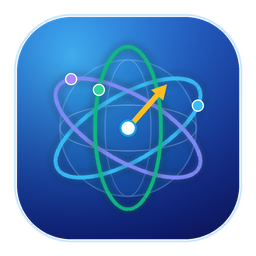

# Quantum Studio EDA v2.5 — 硬核工程量子演化求解、ZNE 零噪声外推、参数移位 VQE 与跨硬件综合工作台

<p align="center">
  
</p>

一套集成了 **QuTiP（稀疏林德布拉德主方程，≤9Q）**、**Kraus（张量收缩密度矩阵，≤14Q）**、**Trajectory（多线程态矢量与蒙特卡洛量子轨迹，≤24Q）**、**Stim（伴随反演稳定子态保真度与高速采样，500+Q）**、**DAG 硬件感知量子线路综合优化器（100+Q）**、**零噪声外推（ZNE）量子误差缓解**、**参数移位法则（Parameter-Shift）解析梯度 VQE**、**OpenQASM 2.0/3.0 与 LaTeX Quantikz 导出** 以及 **多轮对话式 AI 量子线路助手** 的桌面与 Web 一体化工作台。

---

## 核心特性

1. **全尺度四级量子演化与噪声求解器 (`QuantumSolver`)**：
   - **`backend="qutip"`（实验脉冲主方程级，≤9Q）**：基于 CSR 稀疏算符与 `qutip.mesolve` 求解含时脉冲哈密顿量 $H(t) = H_{\text{drift}} + \sum_j c_j(t) H_j$（支持余弦、高斯与矩形包络及同层并行脉冲演化）与林德布拉德主方程（$T_1$ 弛豫、$T_2^*$ 纯退相干、静态 $ZZ$ 串扰与门内连续 Bloch 轨迹）。
   - **`backend="kraus"`（张量收缩密度矩阵级，≤14Q）**：基于 $O(2^k \cdot 4^N)$ 张量轴收缩演化任意非 Clifford 门与 CPTP 噪声通道。
   - **`backend="trajectory"`（纯态矢量与配对蒙特卡洛量子轨迹级，≤24Q）**：无噪时单遍精确态矢量演化，含噪时多线程配对量子轨迹解卷绕计算无偏态保真度与 SWAP-test 纯度 $\text{Tr}(\rho^2)$。
   - **`backend="stim"` / `"stim_qutip"`（大规模稳定子与量子纠错级，500+Q）**：支持伴随反演精确稳定子态保真度（捕捉 $Z$ 相位翻转错误）、逐步存活曲线与 `np.packbits` 超大规模比特串统计。

2. **硬件感知量子线路综合优化器 (`QuantumCircuitOptimizer`) 与 OpenQASM 2.0/3.0 双向互通**：
   - 支持中性原子里德堡阵列（含二维光镊坐标与阻塞半径 $R_b$ 拓扑）、超导 `CZ / iSWAP / CNOT`、离子阱 `MS` 及自定义硬件原生门集（支持递归嵌套复合门）；
   - 单比特 Euler 分解 + 两比特 KAK/Cartan 最优综合 + SABRE 动态拓扑路由 + 三级等价验证（支持 `100+Q`）；
   - 支持 **OpenQASM 2.0 / 3.0 双向编辑与 `.qasm` 文件直接导入导出**。

3. **VQE / QAOA 变分能量景观扫描与 AI 量子线路助手 (`Ctrl+K`)**：
   - 参数扫描模式支持输入任意泡利哈密顿量计算变分能量期望值 $\langle H \rangle$（含一键生成二维伊辛 `TFIM`、海森堡 `XXX`、`MaxCut` 代价函数及基态能量极小点定位）；
   - AI 助手支持生成与多轮精调最高 `500Q` 的对数深度无交叉 GHZ、17Q 旋转表面码、Steane 7Q、Shor 9Q、二维 Cluster 簇态、VQE、QAOA、QFT 与 Grover 搜索线路。

4. **60fps 渐进式脉冲演化动画与专业桌面体验**：
   - $O(1)$ 零空单元格高性能线路画布、2× Retina 3D 交互式 Bloch 球、全寄存器激发态分布图、任务一键中止（Stop）与快捷键速查面板。

---

## 安装与快速启动

### 方式一：使用免配置 `.exe` 安装包（推荐）
直接从 [GitHub Releases](../../releases) 下载 **`QuantumStudio_v2.5.0_Setup.exe`**（已完整内嵌 Python 3.13、QuTiP、SciPy、Stim 及前端构建产物，无需本机安装 Python 或 Node.js）：
- 双击 `QuantumStudio_v2.5.0_Setup.exe`，选择安装目录即可自动释放并创建桌面/开始菜单快捷方式及标准 `Uninstall.exe` 卸载程序（支持 Windows「设置 → 已安装的应用」一键卸载）。

### 方式二：项目目录直接运行（已内嵌 `python_env/`）
```powershell
# 1. 直接双击原生桌面启动器（无命令行黑框，带专属图标）
.\QuantumStudio.exe

# 2. 或使用批处理 / 内嵌 Python 启动桌面窗口
.\start_studio.bat
.\python_env\python.exe run_studio.py

# 3. 以本地 Web 服务模式启动（浏览器访问 http://127.0.0.1:8765）
.\python_env\python.exe run_studio.py --web --open-browser --port 8765

# 4. 运行全套单元测试
.\python_env\python.exe -m pytest tests/test_solver_and_optimizer.py -v

# 5. 重新打包单文件 .exe 安装程序
.\python_env\python.exe scripts/build_installer.py
```
